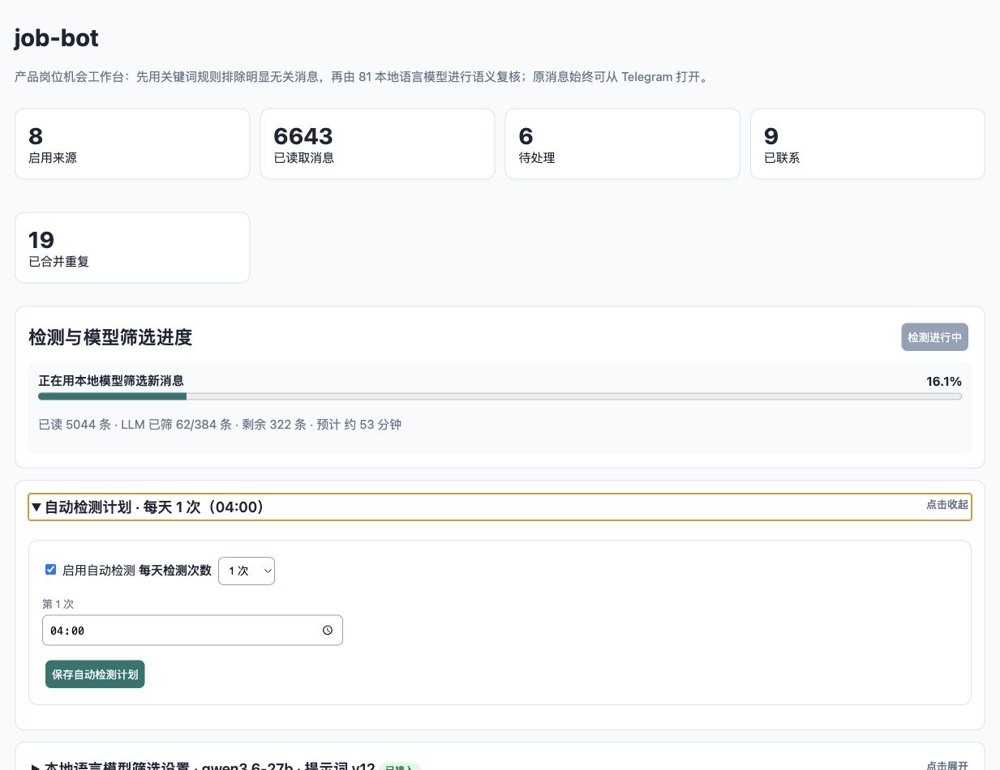

# job-bot

## 项目目的

在指定时间扫描用户授权的 Telegram 群组或频道，只处理上次成功读取位置之后的新消息；根据可配置的求职条件筛选候选信息，并在本地管理页面展示、复核和导出。

权威目录就是本机 `/home/ubuntu/job-bot`。旧局域网工作站 81 已下线，以后也不再用。不要再查 `192.168.1.81`、不要再走 Mac ↔ 81 对拷。

管理页面跑在本机 `127.0.0.1:8888`，公网 `https://job.sakuralost.com`（宿主机 nginx → 8888，再经 `cloudflared-sites` 隧道出网），并启用管理员认证。Telegram 登录会话已授权；管理员可在后台启用或暂停自动检测，设置每天检测次数和每次的北京时间。自动任务先增量读取消息并进行规则初筛，再由本机环境变量 `OPENAI_MODEL` / `OPENAI_BASE_URL` 配置的 OpenAI 兼容模型按岗位段落做语义复核。接口地址和密钥不写入仓库。模型结果写入本机 Docker 里的 PostgreSQL，失败消息保留并自动重试，不会因单次超时而丢失。

## 管理后台预览



管理员可在管理页面通过顶部标题展开或收起“本地语言模型筛选设置”，编辑框底部也提供一键收起按钮，直接编辑中文系统提示词。每次保存都会创建新版本，尚未开始复核的下一条消息会采用最新版本；已经完成的结果不会自动重跑。页面保留最近版本并支持恢复，数据库同时记录每条消息所使用的模型名称、提示词版本和完成时间，方便复核筛选效果。模型必须用中文输出匹配理由和摘要；候选卡片默认同时展示 Telegram 原消息全文和已展开的模型整理摘要。

管理页面顶部提供“APP 产品经理”独立分类，只显示明确负责 APP、移动端、iOS、Android 或 Mobile App 且尚未人工处理的产品岗位。点击“忽略”时会先在卡片内填写原因，确认后岗位卡片会在当前页面直接消失，不触发整页刷新，并进入对应状态页；“保留”和“已联系”也会直接完成。人工状态优先于 APP 分类和后续模型重新筛选。分类结果保存在 PostgreSQL 中；新消息分类和历史重新筛选都会同步更新，不依赖页面临时搜索。

人工填写的忽略原因长期保存在岗位去重组中，并显示在“已忽略”页面。筛选新岗位时，系统会把最近 `30` 条不同的忽略原因作为个性化偏好附加给模型；`30` 条表示用于控制上下文长度的正常上限。这些原因不会直接变成无条件排除规则，只有新岗位明确命中相同特征时才降低匹配度或排除，且模型需要用中文说明影响。

去重长期保存在现有 PostgreSQL 中，不另建第二套业务数据库。每个岗位会同时保存原文、公司加岗位和包含联系方式的结构化内容等多种稳定指纹；转发时只有排版、空白、标点或大小写变化也会被识别。用户选择“保留、忽略、已联系”后，决定写入岗位去重组并长期继承，已忽略的岗位再次出现时同样会直接参与去重。历史重新筛选使用数据库任务清单记录进度，可在中断后继续，且不会因重新筛选丢失人工决定。

正文去重现在位于模型调用之前：同一招聘内容只保留第一条进入模型，后续排版、标点、空白、大小写或全半角变化的转发会直接记录为重复。已经由旧提示词排除的内容在提示词升级后仍允许重新复核，避免旧模型结论永久阻止新版本判断。模型每次返回的结构化结果会保存在消息记录中；规则已经确认存在明确产品岗位、但模型返回“不是产品岗位”时，系统会进行一次针对性一致性复核。模型明确识别到排除项时仍按排除处理，只有真实招聘且没有排除理由的矛盾结果才以 50% 匹配度进入候选区并标注人工复核。

管理页面使用一条紧凑进度条实时展示主动检测：读取阶段持续更新已读消息数，模型阶段展示已筛选数量、剩余数量和预计时间，完成后保留上次完成时间。页面每 `2` 秒刷新一次状态；`2` 秒表示接近实时且不会频繁刷新整页。没有历史重筛任务时不再显示空白进度区域；存在历史重筛任务时可展开查看独立进度。

“立即检测新消息”按钮和后台自动检测都会从每个启用来源各自上次成功记录的位置继续读取，不会重新扫描旧消息。顶部“启用来源”可打开简单管理弹窗，粘贴公开 `t.me` 链接或 `@用户名` 即可添加，无需 Telegram 账号预先订阅；私密来源仍要求当前账号已经加入并有读取权限。全新来源第一次只回看近 `3` 天消息；`3` 天表示避免新来源导入大量过期内容的正常上限。屏蔽来源只停止后续扫描，不删除历史消息、原始职位或已保存岗位；在管理来源页面可直接重新启用。第三方网站来源每次只检索发布时间在近 7 天内的职位。自动检测计划保存在 PostgreSQL，后台修改后约 `15` 秒内生效；`15` 秒表示无需重启服务的正常检查间隔。Telegram 读取与模型筛选分别使用互斥锁，避免主动任务、自动任务和历史重筛互相抢占；模型忙碌时，新消息会先保存并显示为“等待模型空闲”。

公网入口：`job.sakuralost.com` → 本机 nginx → `127.0.0.1:8888`。隧道是本机 `cloudflared-sites`（与 iavow 那条隧道分开）。不要再写 `holiostar-81`。管理员密码认证仍在。

## 通用职位库（为后续对外服务准备）

`web_job_listings`（招聘网站职位原始表）保存所有已接入招聘网站的远程职位，不限产品经理，并同时保存平台原始 JSON（接口原文）、标准字段、来源、发布时间、原始申请链接和处理状态。`job_posts`（当前产品经理精选表）仅保存经过现有筛选流程后适合在 `job.sakuralost.com` 展示的职位，因此主站范围不因通用库扩大而改变。原始申请链接按招聘网站要求原样保存和展示，不追加跟踪参数。

通用职位库目前只作为内部数据层，尚未直接开放外部 API；后续对外前还需要单独确定访问权限、限流、字段脱敏和服务条款。

## 权威目录

| 位置 | 角色 | 编辑规则 |
| --- | --- | --- |
| `/home/ubuntu/job-bot` | **唯一工作副本** | 代码、配置和数据结构变更只在这里做。 |

81 与 Mac iCloud 双端同步已经停用。`scripts/sync_to_mac.sh` 保留但不许再跑。会话、密钥、数据库、缓存和运行日志不要提交到 Git。

## 计划目录

```text
job-bot/
├── README.md
├── docs/                 # 类型、运维与安全说明
├── app/                  # 网页管理端与后端 API
├── worker/               # Telegram 增量读取、筛选和定时任务
├── prompts/              # 模型筛选提示词和版本记录
├── config/               # 不含密钥的配置模板
├── data/                 # Telegram 会话等运行数据，不纳入 Git
├── scripts/              # 启停、凭据和健康检查脚本
├── deploy/               # Docker 与 systemd 定义
└── tests/                # 自动化测试
```

运行：`docker compose`。`job-bot-app` 用 host 网络听 `8888`；`job-bot-postgres-1` 只绑 `127.0.0.1:5432`。环境文件放在项目目录的 `job-bot.env`（权限 600），已被忽略，不要提交。

## 运行边界

- Telegram 仅以用户明确授权的会话读取指定公开或已加入的群组/频道；不发送消息、不邀请成员、不做自动回复。
- 仅保存完成筛选所需的消息、来源、发送者公开用户名/数值 ID、时间、链接和筛选理由；密钥、会话文件和原始敏感内容不进入 Git。
- 管理页面听本机 `8888`，公网只经 nginx + Cloudflare 隧道；使用管理员密码认证。
- 业务数据在本机 Docker PostgreSQL；Telegram 会话、数据库、密钥、缓存和日志均不进入 Git。
- 分类模型走本机环境变量配置的 OpenAI 兼容接口，不在本机跑 Qwen / llama-server。接口地址和密钥只放在 `job-bot.env`。

## 当前筛选工作流

1. 从后台启用的已授权来源按各自读取位置获取新消息；全新来源首次仅回看近 `3` 天内容。
2. 使用 `config/filters.yaml` 中的岗位词、招聘意图词和高风险行业词进行快速初筛，并在调用模型前完成正文去重。
3. 将未重复的候选消息发给已配置的 OpenAI 兼容模型，判断是否为产品岗位、是否远程、是否属于排除行业，并提取公司、薪资和联系方式；明确产品岗位与模型结果矛盾时自动进行一次一致性复核。
4. 保存结构化结果、模型名称和提示词版本；超时或格式错误的消息保留为待重试。
5. 在管理页面搜索、查看原消息，并标记“保留、忽略、已联系”。

提示词更新只改变之后的复核。若要用新提示词重新评估历史结果，应创建可恢复的历史重新筛选任务；任务固定使用创建时的提示词版本，并重新检查去重组里的全部历史候选，包括被旧提示词排除但可能被新提示词重新接受的岗位。任务会记录每条岗位的完成、排除、重复或错误状态，避免模型长时间运行中断后从头开始；未完成的旧提示词任务会标记为“已被新提示词替代”。

本机不再跑 81 上那套双显卡 Qwen3.6-27B。2026-07-31 那次 Ollama / llama-server / NVIDIA Xid 记录只作历史，不要按它在本机再起本地大模型。

## Telegram 代理

Telegram 走本机共享代理 mihomo：`127.0.0.1:7897`。`compose.yaml` 和 `job-bot.env` 已统一这个端口。旧工作站上的独立代理 `7898` 已不用。

详细计划见 [docs/PROJECT_PLAN.md](docs/PROJECT_PLAN.md)，Telegram 授权教程见 [docs/TELEGRAM_SETUP.md](docs/TELEGRAM_SETUP.md)。
