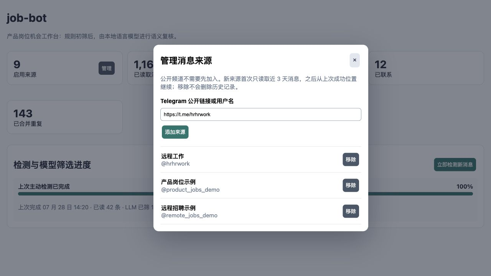

# job-bot

一个自托管的 Telegram 招聘信息筛选机器人：用你自己已授权的 Telegram 账号增量扫描指定群组/频道，先用规则做便宜的粗筛，再交给一个本地/自托管的 LLM（大语言模型）做语义复核，最后在一个轻量网页工作台里让你逐条查看、去重、标记状态。

## 为什么不只靠关键词规则

招聘信息经常是"一贴多岗"：同一条消息里混着 Flutter 工程师、运维、产品经理好几个不相关的岗位。纯关键词规则只能判断"消息里出现了产品经理这个词"，却分不清这条消息到底是不是真的在招产品经理——很容易把"顺带提了一句产品经理"的无关消息当成命中。

job-bot 的做法是：规则层先做**便宜的粗筛**（同时命中"目标岗位词"和"招聘意图词"、且不含硬性排除词才算候选），把候选消息交给 LLM 做**按段落级别的语义判断**——LLM 会识别出消息里是否真的存在一段明确的目标岗位描述，不会因为同一条消息里提到了其他岗位就被带偏。

## 核心能力

- **增量扫描，不重不漏**：每个来源独立维护游标（`last_scanned_message_id`），只读取新增消息；任务失败不会推进游标。
- **规则粗筛 + LLM 语义复核**：LLM 只处理规则筛出的候选消息，控制推理成本；LLM 判断结果包含岗位、薪资、地点、是否远程、排除原因、置信度、判断理由的完整结构化字段。
- **两层长期去重**：LLM 调用前先按消息正文指纹拦截重复转发，模型通过后再按公司名、职位、联系方式和职位描述合并同一机会；已经忽略或联系过的机会也继续参与去重。
- **远程/坐班过滤**：可按需只保留明确写明远程的岗位，排除明确要求到岗坐班的信息。
- **联系方式抽取**：从消息正文里抽取 Telegram 用户名、邮箱、电话、微信等，正则兜底 + LLM 抽取双重来源合并去重。
- **网页工作台**：按状态（待处理/保留/已联系/忽略）筛选、搜索、标记，原始消息链接一键跳转回 Telegram。
- **实时进度**：读取阶段实时显示已读消息数；LLM 阶段显示已筛选、剩余数量和预计完成时间，页面不会整页刷新。
- **后台自动检测计划**：可启用或暂停自动检测，在管理后台设置每天执行次数及每次的具体时间，保存后无需重启。
- **来源管理弹窗**：在顶部直接添加或停用公开 `t.me` 链接和 `@用户名`；全新来源首次只回看近 3 天消息，避免倒灌大量过期内容，停用不会删除历史记录。
- **可版本化中文提示词**：在后台直接编辑、折叠和恢复提示词版本；每条结果保留使用的模型和提示词版本。
- **人工反馈参与后续判断**：忽略岗位时填写原因，系统会将近期反馈作为新岗位匹配的辅助偏好。
- **APP 产品经理分类**：把明确属于移动端、iOS、Android 或 Mobile App 的产品岗位单独归类。
- **对本地 LLM 友好**：不依赖 OpenAI 专属的严格 JSON 模式，对本地模型常见的输出偏差（markdown 代码块包裹、非精确枚举值、字符串中的未转义换行）做了防御性解析。规则与模型判断矛盾时会复核一次；明确排除项仍按排除处理，只有真实招聘且没有排除理由的矛盾结果才进入人工复核。

## 管理后台预览




## 架构

```text
Telegram（已授权账号）
   │  增量读取（游标去重）
   ▼
规则粗筛（config/filters.yaml：目标岗位词 + 招聘意图词 + 硬性排除词）
   │  候选消息
   ▼
正文指纹去重（重复转发不调用模型）
   │  新内容
   ▼
LLM 语义复核（OpenAI 兼容接口，任意模型）
   │  结构化 JSON：岗位/薪资/地点/远程与否/排除原因/置信度/联系方式
   ▼
岗位去重（公司/职位/联系方式/描述）─→ 非远程排除 ─→ 写入 Postgres
   │
   ▼
FastAPI 网页工作台（HTTP Basic 认证）
```

技术栈：FastAPI + SQLAlchemy 2.x + PostgreSQL + Alembic（数据库迁移）+ Telethon（Telegram 客户端库）+ APScheduler（定时任务）+ 任意 OpenAI 兼容 LLM 接口。

## 快速开始

```bash
git clone <this-repo-url> job-bot && cd job-bot
cp .env.example job-bot.env   # 按需修改，权限建议 chmod 600
cp config/monitored_chats.yaml.example config/monitored_chats.yaml
cp config/filters.yaml.example config/filters.yaml
# 使用旧版来源或偏好导入工具时，再复制对应模板
cp config/sources.json.example config/sources.json
cp config/preferences.json.example config/preferences.json
```

编辑 `job-bot.env`：

| 变量 | 说明 |
| --- | --- |
| `JOB_BOT_ADMIN_PASSWORD` | 网页工作台的管理员密码（HTTP Basic，用户名固定为 `admin`） |
| `TELEGRAM_API_ID` / `TELEGRAM_API_HASH` | 从 <https://my.telegram.org> 获取，见 [docs/TELEGRAM_SETUP.md](docs/TELEGRAM_SETUP.md) |
| `TELEGRAM_PHONE` | 登录用 Telegram 手机号（国际格式） |
| `DATABASE_URL` | PostgreSQL 连接串 |
| `OPENAI_API_KEY` / `OPENAI_MODEL` / `OPENAI_BASE_URL` | 任意 OpenAI 兼容 LLM 接口；本地部署可指向自己的 Ollama/vLLM/sglang 网关 |
| `TELEGRAM_PROXY_HOST` / `TELEGRAM_PROXY_PORT` | 如果你的网络环境需要经代理才能连上 Telegram，这里配 SOCKS5 代理；不需要则留空 |

然后：

```bash
docker compose up -d postgres
docker compose run --rm app alembic upgrade head        # 建表
docker compose run --rm app python -m worker.seed_chats  # 导入监控来源
```

完成 Telegram 首次登录授权（详见 [docs/TELEGRAM_SETUP.md](docs/TELEGRAM_SETUP.md)），然后启动主服务：

```bash
docker compose up -d app
```

访问 `http://<你的服务器地址>:8888`，用户名 `admin`，密码为 `JOB_BOT_ADMIN_PASSWORD`。

## 目录结构

```text
job-bot/
├── app/
│   ├── classifier/       # 规则粗筛 + LLM 客户端 + 结构化输出 schema
│   ├── dedup/             # 岗位指纹计算
│   ├── extractor/         # 联系方式抽取与归一化
│   ├── database/          # SQLAlchemy 数据模型
│   ├── services/          # 扫描、进度、提示词、自动计划服务
│   ├── scheduler/         # 定时任务
│   ├── api/               # 健康检查、管理端 API
│   └── dashboard.py       # 网页工作台路由
├── worker/
│   ├── manual_scan.py      # 手动/自动检测任务及断点续跑
│   ├── daily_job.py        # 命令行任务编排（扫描 + LLM 复核）
│   ├── classify_pending.py # LLM 分类主流程
│   ├── cleanup_history.py   # 历史消息安全清理与指纹回填
│   ├── login.py            # Telegram 首次登录
│   └── seed_chats.py       # 导入监控来源
├── config/                # 规则/来源配置模板（真实配置不进 Git）
├── alembic/                # 数据库迁移
├── docs/                   # Telegram 授权教程
└── tests/                  # 单元测试
```

## 隐私与安全边界

- 只以你本人明确授权的 Telegram 会话读取指定的公开或已加入群组/频道；公开来源通常可凭 `t.me` 链接读取，无需账号预先加入，私密来源仍要求账号已有权限。系统不发送消息、不邀请成员、不自动回复。
- 不保存 Telegram 密码、验证码、两步验证密码；`.env`、登录会话文件、数据库均被 `.gitignore` 排除，不会进入版本控制。
- 网页工作台默认只做 HTTP Basic 认证，建议只在受信任的局域网内暴露，或自行加一层反向代理认证。
- `config/monitored_chats.yaml`、`config/filters.yaml`、`config/sources.json`、`config/preferences.json` 是真实来源和筛选策略，同样被 `.gitignore` 排除——仓库里只有 `.example` 模板。

## License

[MIT](LICENSE)
