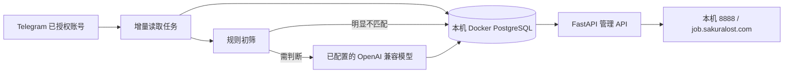

# job-bot 开发计划与项目方案

本机 `/home/ubuntu/job-bot` 是唯一工作副本。旧 81 与 Mac iCloud 同步已停用。

## 1. 目标与完成标准

在用户设定的北京时间计划时段内，使用用户本人授权的 Telegram 会话扫描指定群组/频道的新增消息；逐条判断是否符合求职偏好；将命中的机会和发送者标识保存在可检索页面中。系统重新运行时必须从每个来源上次**成功提交**的消息位置继续，不重复漏读。

可验收标准：

1. 可在页面维护来源清单、扫描计划和求职偏好。
2. 每个来源独立保存 `last_processed_message_id`（最后成功处理的消息 ID）与处理时间。
3. 每条新消息先进行规则初筛，必要时再经模型复核，生成结构化结果和简短理由。
4. 页面可按状态、来源、地点、岗位、薪资、关键词和时间筛选；可标记“保留、忽略、已联系”。
5. 命中记录包含 Telegram `@username`；没有用户名时保存数值 `sender_id`，并明确显示“无公开用户名”。

## 2. 当前架构

- **Telegram 接入**：Python + Telethon。首次登录在本机终端完成手机号、验证码和两步验证；会话文件只放在 `data/`，不写入仓库或页面。出网走本机 mihomo `127.0.0.1:7897`。
- **任务调度**：容器内按配置的北京时间触发；支持多个时段和手动执行。运行互斥，避免同一来源并发造成游标混乱。
- **增量与一致性**：以 `(source_id, telegram_message_id)` 建唯一约束；消息、分析结论和游标在单一数据库事务内提交。任务失败不推进游标，重跑可安全去重。
- **判定链路**：先以岗位、招聘意图和高风险行业规则快速排除；剩余消息才送入环境变量 `OPENAI_MODEL` 指定的模型。模型输出受 JSON Schema 约束，并保存提示词版本、模型名称和判断理由。
- **前端**：FastAPI + 服务端 HTML（Jinja2），少量 HTMX。服务听 `8888`，公网经 nginx + `cloudflared-sites`，管理员密码保护。
- **数据**：PostgreSQL 在本机 Docker，只绑 `127.0.0.1:5432`。会话、数据库、密钥和日志不进 Git。

## 3. 页面规划

| 页面 | 主要内容 | 用户操作 |
| --- | --- | --- |
| 总览 | 最近扫描、命中数、失败来源、下一次扫描 | 手动运行、查看异常 |
| 候选机会 | 命中消息卡片、匹配度、理由、发送者、原文链接 | 筛选、排序、状态标记、导出 CSV |
| 候选详情 | 原消息、结构化岗位信息、模型结论、处理时间 | 保留、忽略、已联系、添加备注 |
| 来源管理 | 群组/频道、启用状态、最近游标与错误 | 新增、暂停、测试读取 |
| 偏好设置 | 必须条件、排除条件、当前模型和版本化提示词 | 保存新提示词、恢复历史版本 |
| 运行记录 | 每次任务处理量、命中量、错误 | 查看日志与重试 |

## 4. 数据与隐私设计

核心表：`sources`、`messages`、`analyses`、`cursor_state`、`runs`、`preferences`。历史上的 `sync_audits` 是 81↔Mac 同步残留，不再作为现行流程。

`messages` 保存来源、Telegram 消息 ID、发送时间、文本、链接和发送者字段。发送者优先保存 `@username`；Telegram 未提供用户名时保存数值 ID 或标记“不可用”。用户名可能会变更，因此页面会同时显示读取时快照与数值 ID（若可获得）。

不保存 Telegram 密码、验证码、两步验证密码；`.env`、`job-bot.env`、会话文件、数据库、日志导出和备份均被 `.gitignore` 排除。会话文件仅运行用户可读。

## 5. LLM 方案

分类走 OpenAI 兼容接口。地址和模型名分别由本机 `OPENAI_BASE_URL`、`OPENAI_MODEL` 配置，不写入仓库。本机不跑 Qwen / llama-server / Ollama。

job-bot 先做规则初筛，再把候选交给串行队列复核；模型超时或返回格式错误时保留消息并在后续任务中重试。连接失败、超时、HTTP 429 或 HTTP 5xx 时，当前整批立即停止，未处理消息保留待重试。

每条候选只传递完成招聘判断所需的正文，模型输出限制为固定 JSON，包括岗位、公司、行业、远程状态、地点、薪资、联系方式、置信度和简短理由。管理员可在管理页面编辑完整系统提示词；每次保存生成新版本。当模型不可用时，任务仍记录规则结果，并标记“待模型复核”，不丢失消息。

## 6. 备份

不要再跑 `scripts/sync_to_mac.sh`。需要备份时在本机做，排除会话、密钥、数据库明文和运行日志。

## 7. 当前实现状态

- 管理页面：本机 `8888`，公网 `https://job.sakuralost.com`，管理员认证。
- Telegram 已授权；来源按各自读取位置增量扫描。
- PostgreSQL、规则初筛、模型复核、联系方式提取、去重和候选状态管理已接通。
- 模型提示词可在管理页面保存为新版本、查看历史并恢复；新版本从尚未开始的下一条消息起生效。
- 自动任务按北京时间执行；模型请求串行。基础设施故障时整批停止，消息保留待重试。
